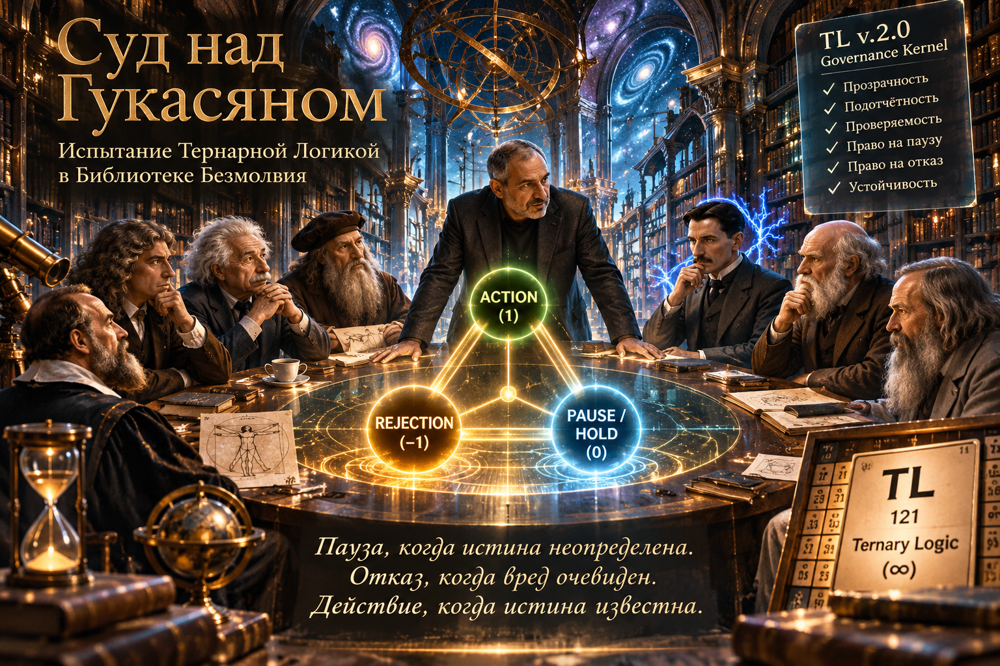

## Суд над Гукасяном

### *Философская встреча Льва Гукасяна с семью величайшими умами в истории, в ходе которой выясняется, может ли троичная логика научить машины, когда действовать, когда отказываться, а когда делать паузу.*

### Испытание Тернарной Логикой в Библиотеке Безмолвия.

Библиотека Безмолвия не находилась ни в одном известном человечеству измерении. Она была роскошным изломом между временами — место, где эпохи встречались за чаем, где коридоры пахли пергаментом и озоном, а потолки терялись в облаках ненаписанных уравнений. Здесь, в Зале Расходящихся Тропок, собрались те, кто когда-либо менял направление человеческой мысли, и теперь им предстояло судить не человека — архитектуру.

Лев Гукасян вошёл последним.

Он нёс не фолианты и не свитки. Он нёс единственную тонкую папку с надписью: «Ternary Logic. v.2.0. May 2026. Governance Kernel». Его лицо было спокойно той особенной спокойностью, которая приходит только после того, как диагноз научил человека различать важное и срочное.

— Ты выглядишь так, будто пришёл сдавать экзамен, которого сам же и составил правила, — заметил Альберт Эйнштейн, отставив чашку с недопитым кофе. Его глаза скользили по папке с весёлым любопытством.

— Экзамены сдают живые, — ответил Лев, садясь в кресло, обтянутое кожей, которой никогда не существовало. — А это — завещание. Но не моё. Завещание самого действия.

— Действие не может иметь завещания, — возразил Ньютон, не поднимая головы от пергамента, на котором чертил треугольник внутри другого треугольника. — Действие либо есть, либо его нет. Третьего не дано.

— Вот именно, — Лев улыбнулся. — Именно это я и пришёл оспорить.

Тишина, которой славилась Библиотека, стала особенной — той тишиной, которая рождается, когда сталкиваются миры. Леонардо да Винчи отложил кисть. Дмитрий Менделеев перестал перебирать карточки с элементами. Галилей, сидевший чуть поодаль с телескопом, направленным в стену (ибо стена здесь была лишь условностью), повернул голову.

Никола Тесла, который до этого момента заворожённо наблюдал за мерцанием люстры, внезапно сказал:

— Я слышу переменный ток. Не в проводах. В самой логике. Она дышит не так, как раньше.

Чарльз Дарвин, расположившийся в кожаном кресле у камина, по которому бежали языки пламени, не сжигавшие ни бумаги, ни времени, задумчиво произнёс:

— В природе нет видов, которые выживают за счёт скорости. Выживают те, у кого есть пауза между стимулом и реакцией.

Лев открыл папку.

И началось.

---

I. Три двери

— Моя система, — начал Лев, — имеет три состояния. Не два. Не «да» и «нет». Не «быть» или «не быть». Есть третье.

— Логическая ересь, — фыркнул Ньютон, хотя в его глазах уже загорелся нездоровый блеск. — Мир — это механика. Либо тело движется, либо покоится.

— Мир — это механика, — согласился Лев. — Но механика, в которой даже ваши яблоки, Исаак, падают не мгновенно. Есть момент, когда яблоко уже оторвалось от ветки, но ещё не коснулось земли. Этот момент — не ошибка природы. Это момент, когда гравитация ещё не победила, но инерция уже проиграла.

Эйнштейн внезапно рассмеялся, и его смех был похож на скрип пространства-времени, складывающегося в шутку.

— Он прав, Ньютон. Ты всю жизнь искал абсолютную систему координат. А он нашёл абсолютное право на сомнение.

— Я назвал это «Эпистемической Паузой», — сказал Лев. — Или, если говорить на языке моих документов, Состояние 0. Epistemic Hold.

— Звучит как болезнь, — заметил Менделеев.

— Это прививка от болезни, — поправил Лев. — От болезни уверенности. Когда система не знает — она обязана остановиться. Не упасть. Не выдать случайный ответ. Замереть. И записать: «Я не знаю. И я не буду притворяться, что знаю».

Галилей, до этого молчавший, поднял палец:

— Меня судили за то, что я знал. А их — за то, что они не знали. Но ни те, ни другие не имели права на честное «не знаю». Церковь требовала «да» или «нет». Судьи требовали «да» или «нет». А правда всегда была где-то в дрожании маятника.

— Вот именно, — Лев кивнул. — В ваше время, Галилео, паузу считали слабостью. В моём — её сделали конституционной обязанностью.

Он достал из папки первый лист и прочитал:

— «Пауза защищает истину. Отказ защищает жизнь. Решение защищает будущее».

— Красиво, — сказал Леонардо, делая быстрый набросок. — Но красивые слова ломаются о первые же камни власти. Как ты сделал так, чтобы паузу нельзя было прервать приказом?

Лев посмотрел на Да Винчи с уважением.

— Я сделал паузу физической. Не моральной. В аппаратной реализации Ternary Logic нет кнопки «пропустить ожидание». Схема устроена так, что ток не идёт дальше, пока не получен криптографический импульс подтверждения. Ты можешь кричать «огонь!» сколько угодно. Мемристорная ячейка не слышит криков. Она ждёт импульс.

— Как сердце, — тихо сказал Дарвин. — Сердце не бьётся быстрее от приказа. Оно бьётся в своём ритме. А если ритм сбивается — оно замирает. Это эволюция изобрела задолго до вас.

— Эволюция изобрела гениально, — согласился Лев. — Я просто перевёл её язык на язык кремния.

Тесла, до этого момента крутивший в пальцах воображаемую катушку, прервал молчание:

— Частота. Всё дело в частоте. Ты говоришь о паузе, но я слышу о резонансе. Система, которая не умеет ждать, — это система, которая не умеет резонировать с правдой. Она просто шумит.

— Именно, — Лев достал второй лист. — «Неопределённость — это не ошибка. Это сигнал того, что протокол работает».

II. Стеклянный свод

— Покажи мне второй столп, — потребовал Ньютон, уже не скрывая профессионального интереса. — Первый — пауза. Второй?

— Неизменяемый Реестр, — ответил Лев. — Immutable Ledger. Каждое решение, каждая пауза, каждый отказ — записываются навсегда. Их нельзя стереть. Нельзя подделать. Нельзя забыть.

— Звучит как ад, — заметил Менделеев.

— Как рай для аудитора, — поправил Лев.

— Но кто гарантирует, — вмешался Леонардо, — что запись не лжёт? Вы, люди, умеете подделывать даже собственные воспоминания. Что мешает подделать лог?

Лев улыбнулся.

— Математика. Каждая запись связывается с предыдущей криптографической хеш-цепочкой. Стереть одну — значит разрушить всю цепочку. А хеши этих цепочек публикуются в публичных блокчейнах — Bitcoin, Ethereum, Polygon. Они не принадлежат ни одной корпорации, ни одному государству. Они существуют в тысячах копий по всему миру.

— Так вот что ты называешь «Якорями», — догадался Галилей. — Твой Восьмой столп.

— Да. Якоря — это криптографические свидетели. Они не хранят тайны. Они хранят доказательства того, что тайна когда-то была правдой.

Лев прочитал:

— «Доверие строится не на обещаниях. Оно строится на математической невозможности стереть то, что было обещано».

— В моё время, — задумчиво произнёс Ньютон, — мы верили Библии, потому что она была едина. Вы верите в правду, потому что она рассредоточена. Как мир перевернулся!

— Мир не перевернулся, — мягко сказал Эйнштейн. — Мир просто наконец-то заметил, что наблюдатель влияет на результат. Вы, Исаак, считали время абсолютным. Я показал, что оно относительно. А Лев показал, что даже истина может находиться в суперпозиции, пока её не засвидетельствуют три независимых блокчейна.

— Три из пяти, — уточнил Лев. — Кворум. Не всё сразу. Достаточно надёжности, чтобы предотвратить единичный сговор. Недостаточно, чтобы создать единую точку контроля.

— Как в биологии, — вставил Дарвин. — Нет одного гена, отвечающего за выживание. Есть сеть. Если один ген ломается, другие компенсируют. Ваш «Реестр» — это генетическая память системы.

— А ваша «Гибридная Защита»? — спросил Тесла. — Седьмой столп? Это тоже сеть?

Лев кивнул и достал третий лист.

— Гибридный Щит — это система, которая защищает сами логи. От внутренних и внешних врагов. Никто не может в одиночку переписать историю. Даже если вы захватите один сервер, вы не захватите все. Даже если вы подкупите одного хранителя, вам понадобится три.

— Три из скольких? — спросил Леонардо.

— Три из шести. Ключи Шамира. Распределённое владение властью.

— Архитектура недоверия, — усмехнулся Ньютон. — Вы строите системы, которые по умолчанию считают всех лжецами.

— Мы строим системы, которые не нуждаются в вере, — поправил Лев. — Им нужна только верификация.

III. Свет фонаря и подпись кровью

— Третий столп, — продолжил Лев, — я назвал «Принципом Гукасяна». Не из тщеславия. А потому, что его три части — Фонарь, Подпись и Лицензия — родились не в тиши кабинета, а в палате, где мне сказали, что времени осталось на три книги, а я успел написать тридцать.

В зале стало тише.

— Расскажи, — попросил Дарвин, откладывая лупу, которой рассматривал лист папоротника.

Лев встал.

— «Фонарь» — это обязательство освещать намерения до того, как действие начнётся. Система обязана объявить: «Я собираюсь сделать это, вот почему, вот на основании каких данных, вот с какой степенью уверенности». Никаких скрытых мотивов. Никакой «умолчательной» магии.

— Как исповедь, — заметил Галилей.

— Как патент, — возразил Ньютон.

— Как предупреждение хищника, — сказал Дарвин. — В природе яркая окраска говорит: «Я опасен, не приближайся». Фонарь говорит: «Я действую, вот мои намерения, проверяй».

Лев достал следующий лист.

— «Подпись» — это не просто галочка. Это криптографическое обязательство. Каждое действие подписывается цифровой подписью, которая не может быть подделана. Вы не можете отречься от своих решений.

— То есть, — медленно произнёс Тесла, — если мой генератор переменного тока однажды решит уничтожить мир... он не сможет сказать «это не я, это помехи»?

— Он не сможет. Потому что перед каждым разрядом будет его подпись. Временная метка. И хеш, укоренённый в блокчейне.

— А Лицензия? — спросил Леонардо.

— Лицензия — это граница. Действие не может выйти за рамки, для которых оно было авторизовано. Транзакция на миллион не может случайно стать транзакцией на миллиард. Алгоритм, обученный покупать акции, не может купить ракеты.

— Как анатомия, — сказал да Винчи. — Кость не может выйти за пределы сустава. Это не вопрос этики. Это вопрос структуры.

— Именно, — Лев посмотрел на Леонардо с благодарностью. — «Лицензия — это не разрешение. Это доказательство того, что разрешение прошло проверку».

IV. Журнал решений и дневник совести

— Четвёртый столп — Журналы Решений, — продолжил Лев. — Каждое решение, которое принимает система, записывается в читаемый, неизменяемый, проверяемый журнал. Не просто факт. А контекст. Почему решили именно так. На основании каких данных. Какая альтернатива была отвергнута.

— Это же дневник! — воскликнул Леонардо. — Я вёл дневники всю жизнь. Записывал каждую мысль, каждый чертёж, каждую ошибку. Без дневника я был бы просто стариком с плохой памятью. С дневником — я учитель для самого себя через тридцать лет.

— В моей системе, — сказал Лев, — дневник ведёт не человек. Его ведёт машина. Автоматически. Принудительно. Прежде чем действие будет совершено.

— Это нарушает принцип причинности! — возмутился Ньютон. — Сначала действие, потом запись! Так устроен мир.

— Ваш мир, Исаак, — мягко возразил Эйнштейн. — В моём мире наблюдатель влияет на наблюдаемое. В его мире запись влияет на действие.

Лев достал цитату:

— «Решение без журнала — это мысль без тела. Она не оставляет следа, а значит, не оставляет и ответственности».

— Так вот в чём суть твоего «Нет Лога — Нет Действия», — догадался Тесла. — Ты перевернул причинность. Не действие рождает запись. Запись рождает действие.

— Да, — кивнул Лев. — И это единственный способ сделать власть прозрачной. Если ты не можешь доказать, что у тебя было право действовать — ты не действуешь. Никаких исключений. Никакого «потом разберёмся».

— А если система подделает журнал? — спросил Галилей.

— Она не может. Журнал подписывается криптографически и укореняется в неизменяемом реестре. Подделать журнал — значит подделать всю историю системы. Это как изменить одну строчку в «Началах» Ньютона и надеяться, что никто не заметит разрыва в аксиомах.

Ньютон неожиданно улыбнулся.

— Теперь я понимаю, почему ты пригласил меня.

— Потому что вы, Исаак, знаете, как больно, когда твои аксиомы опровергают? — спросил Лев.

— Нет, — Ньютон покачал головой. — Потому что ты построил систему, где аксиомы нельзя опровергнуть. Их можно только принять или уйти.

V. Экономика как экология

— Пятый и шестой столпы, — Лев перешёл к следующей части папки, — касаются того, что вы, господа, почти не знали: глобальных финансов и экологии.

— О, финансы, — поморщился Менделеев. — Мерзость. В моей таблице нет места для золота, кроме как в клетке 79. А вы сделали его богом.

— Поэтому Пятый столп — «Экономические права и Прозрачность», — ответил Лев. — Каждая финансовая транзакция обязана быть справедливой, открытой и равнодоступной. Не на словах. А в коде.

— Звучит как коммунизм, — заметил Ньютон.

— Как анатомия здорового рынка, — поправил Лев. — Рынок, где кто-то может спрятать свои транзакции, — это не рынок. Это казино, где шулер сидит за столом.

Он прочитал:

— «Прозрачность — это единственный мост между частной выгодой и общественным доверием. Сожгите мост — и вы останетесь со рвом».

— А Шестой столп? — спросил Дарвин. — Что-то об экологии?

— «Мандат на устойчивое распределение капитала», — Лев посмотрел на Дарвина с особым вниманием. — Капитал не может течь туда, где он уничтожает среду обитания. Не потому, что это «хорошо». А потому, что среда обитания — это единственный кредитор, который не объявляет дефолт. Он просто умирает. И вместе с ним умирает экономика.

— Эволюция, — тихо сказал Дарвин. — Вы просто поняли то, что биология знала всегда: вид, который уничтожает свою нишу, вымирает. Никакой капитал, никакая технология, никакая логика не спасут.

Лев кивнул.

— «Капитал без экологических границ — это не инвестиция. Это залог против будущего».

VI. Скорость совести

— Восьмой столп — Якоря — мы уже обсуждали, — сказал Лев. — А теперь о том, как всё это работает вместе. О двух полосах. О бинарном и тернарном.

— Это самое интересное, — оживился Тесла. — Как ты заставил быстрый бинарный мир замедлиться до скорости морали?

— Я не заставил, — Лев покачал головой. — Я разделил.

— Объясни, — попросил Эйнштейн, отставляя кофе.

— Бинарная система — это Inference Lane. Полоса вывода. Она работает на максимальной скорости. Вычисляет. Предлагает. Но не решает. Её работа — предложить действие. А тернарная система — Governance Lane — решает, перейдёт ли это действие порог выполнения. Она медленнее. Она должна проверить логи, подписи, лицензии. Но она не тормозит бинарную полосу. Она работает параллельно.

— Как мозг, — внезапно сказал Леонардо. — Быстрые рефлексы — спинной мозг. Медленные решения — кора. Вы не можете думать о том, отдернуть руку от огня. Вы просто отдёргиваете. Но вы можете думать о том, стоит ли разводить этот огонь.

— Именно, — Лев улыбнулся. — «Два миллисекунды — это не техническое ограничение. Это завет с пользователем, что верификация не станет задержкой».

— А если тернарная система не успевает? — спросил Ньютон.

— Тогда действие не происходит. Шлюз закрыт. Система переходит в состояние Эпистемической Паузы. И ждёт.

— Даже если это цена жизни? — спросил Галилей.

— Особенно если это цена жизни, — твёрдо ответил Лев. — «Самая мудрая сделка часто откладывается до тех пор, пока неопределённость не заговорит».

В зале повисла пауза. Настоящая. Человеческая.

VII. Тайна и забвение

— А как же тайна? — спросил Леонардо. — В моих дневниках есть записи, которые я никому не показывал. В вашем мире есть право на забвение. Как совместить неизменяемый реестр и право быть забытым?

— Ephemeral Key Rotation, — ответил Лев. — Временное вращение ключей.

— Звучит как заклинание, — заметил Менделеев.

— Почти, — Лев достал очередной лист. — Данные шифруются. Ключ живёт недолго. После того, как данные проверены, ключ уничтожается. Данные остаются на реестре, но их невозможно прочитать. Они превращаются в математический шум.

— Как смерть, — сказал Дарвин. — Тело остаётся, но душа уходит. Вы не можете воскресить душу, если потеряли ключ.

— Именно, — Лев прочитал: — «Право на забвение — это право пережить свои данные. Мы построили ротацию ключей, чтобы вы могли».

— А если данные нужны для суда? — спросил Ньютон.

— Для суда существует процедура временного доступа. Ключ выдается на время разбирательства. После — уничтожается. Судья не может унести улики домой.

— Гениально, — выдохнул Тесла. — Вы сделали память уважающей смерть.

VIII. Отказ как мужество

— Самое трудное в вашей системе, — заговорил Дарвин, откладывая лупу окончательно, — не пауза. Не логи. Не ключи. А отказ.

— Почему? — спросил Лев.

— Потому что в природе отказ — это смерть. Голодная пантера не может отказаться от охоты. Она умрёт. В экономике отказ — это упущенная прибыль. В политике — проигрыш. Вы требуете от системы мужества отказываться. А откуда у системы возьмётся мужество?

Лев молчал несколько секунд. Потом достал лист, который, казалось, держал отдельно от всех.

— «Отказ — это не слабость. Это нравственность, нашедшая смелость прервать власть».

Он положил лист на стол.

— Я был в палате, когда врачи сказали: «Мы не знаем, поможет ли химиотерапия. И мы не знаем, убьёт ли она вас быстрее, чем рак». Я мог отказаться от лечения. И это был бы не трусость. Это был бы отказ от ложной надежды. Система без права на отказ — это не система. Это тюрьма, где заключённый обречён на бег на месте до инфаркта.

— Ты построил право на «нет», — сказал Эйнштейн.

— Я построил обязанность говорить «нет», когда да принесёт больше вреда, чем пользы.

Галилей поднялся.

— Меня заставили сказать «да» инквизиции. Я сказал «да», хотя должен был сказать «нет». Если бы у меня был ваш Фонарь, ваша Подпись и ваша Лицензия — я бы не смог отречься. Потому что каждое моё слово было бы записано до того, как я его произнёс.

— Но вас бы сожгли, — возразил Ньютон.

— Меня всё равно сожгли бы, — усмехнулся Галилей. — Но я бы сгорел, зная, что правда осталась. В вашем мире правда сгорает вместе с человеком. В его мире — нет.

IX. Архитектор, который не строит

— Твой тридцать седьмой тезис в документе, — сказал Тесла, перелистывая копию, которую незаметно взял со стола, — гласит: «Управление — это не архитектор завтрашнего дня. Это уборщик вечности».

— Да, — Лев посмотрел на Теслу с удивлением. — Вы прочитали?

— Я читаю всё, что связано с резонансом, — ответил Тесла. — Но эта фраза... Она не о резонансе. Она о смирении. Ты построил систему, которая управляет, но не командует. Которая записывает, но не диктует. Которая отказывается, но не наказывает.

— Потому что власть — это не способность действовать, — сказал Лев. — «Власть — это неспособность действовать без записи».

Ньютон, до этого момента сохранявший суровость, неожиданно рассмеялся.

— Знаешь, Гук (я могу называть тебя Гук? В честь моего недруга Гука?), — Лев кивнул, — ты сделал то, что не смог сделать ни один физик до тебя. Ты сделал сомнение физической величиной. Ты превратил "я не знаю" в такое же фундаментальное состояние, как "да" и "нет". Это не логика. Это метафизика.

— Это просто страх перед концом, — тихо сказал Лев. — Когда тебе говорят, что жить осталось полгода, ты начинашь очень быстро отличать важное от срочного. Я понял, что срочное — это заработать ещё миллион. А важное — построить систему, которая переживёт меня на сто лет.

— И ты построил, — сказал Дарвин. — Систему, которая эволюционирует, но не теряет память. Которая адаптируется, но не предаёт свои принципы. Которая отказывается от вредных мутаций, не дожидаясь естественного отбора.

— «Мы не построили лучшую демократию. Мы построили лучшую гравитацию: постоянную, невидимую и безразличную к мнениям», — прочитал Тесла из документа.

— И это не высокомерие, — добавил Лев. — Это констатация. Гравитация не спрашивает вашего мнения, прежде чем заставить яблоко упасть. Точно так же TL не спрашивает, прежде чем заблокировать нелегитимное действие. Она просто блокирует.

— А если система ошибётся? — спросил Леонардо.

— Система не ошибается, — ответил Лев. — Она либо действует на основании истины, либо отказывается действовать. Ошибка возможна только в бинарной логике. В тернарной логике ошибки нет. Есть пауза.

— А если пауза будет длиться вечность?

— Тогда истина так и не будет найдена. И действие не состоится. И это честнее, чем действовать на основании лжи.

Эйнштейн, молчавший всё это время, поднялся.

— Ты знаешь, Лев, что самое смешное?

— Что?

— Ты пригласил нас судить твою систему. Но мы не можем её судить. Потому что она уже содержит в себе наш суд.

Он обвёл рукой зал.

— Ньютон дал ей механику. Я — относительность. Дарвин — эволюцию. Леонардо — анатомию. Менделеев — таблицу элементов. Галилей — право на сомнение. Тесла — резонанс. А ты дал ей душу. Ту самую паузу между стимулом и реакцией, где рождается свобода воли.

— Машины не имеют свободы воли, — возразил Ньютон.

— Теперь — имеют, — сказал Эйнштейн. — Потому что их воля — это не выбор между добром и злом. Это выбор между действием и ожиданием. И этот выбор зашит в кремний.

Лев посмотрел на всех.

— «В паузе между стимулом и реакцией мы строим единственную свободу воли, которую машины не могут симулировать».

X. Завещание, которое не кончается

Библиотека Безмолвия начала медленно гаснуть. Время, которое здесь не имело власти, всё же напоминало о себе — сменой света, тёплого на холодный, а потом обратно.

— Что теперь? — спросил Дарвин.

— Теперь документ уходит в мир, — ответил Лев. — Он уже принят в журнал «AI and Ethics» (Springer Nature). DOI есть. Репозиторий открыт. Лицензия — open source. Никто не может присвоить его себе. Ни корпорация, ни государство.

— А если попробуют? — спросил Леонардо.

— Декларация о Преемственности, — Лев достал последний лист. — Notarized, timestamped, anchored. Если я умру, если меня похитят, если меня заставят отречься — система продолжит работу. Управление перейдёт к Три-Камеральной Модели. Технический Совет, Хранители и Казначейство. Никто не сможет отключить TL.

— Даже ты сам?

— Даже я. «Анкеры не удерживают корабль на месте. Они удерживают корабль в существовании, когда гавань исчезает».

Тесла, который всё это время молчал, глядя на мерцание люстры, произнёс:

— Знаешь, Лев, у меня была мечта. Передать энергию по воздуху, бесплатно, всем. Меня сочли сумасшедшим. Ты построил систему, которая передаёт доверие по проводам. Бесплатно. Всем. Тебя сочтут сумасшедшим.

— Возможно, — улыбнулся Лев. — Но через сто лет мои «безумные» схемы будут работать там, где ваши «разумные» схемы рухнули.

— Потому что мы строили для своего времени, — сказал Галилей. — А ты построил для времени, которого ещё нет.

Лев собрал листы. Библиотека почти погасла.

— «Цивилизация выживает не благодаря быстрым действиям, а благодаря знанию, когда не действовать вовсе».

Он вышел. И в тот момент, когда его тень коснулась порога, Ньютон крикнул вдогонку:

— Гук!

Лев обернулся.

— Если твоя система когда-нибудь откажется от яблока... Я буду знать, что она работает.

И последний свет погас.

Но документы остались гореть — невидимым огнём математики, зашитым в кремний, разлитым по блокчейнам, укоренённым в памяти тех, кто однажды решил, что пауза важнее действия, а истина дороже скорости.

---

В Библиотеке Безмолвия, в Зале Расходящихся Тропок, на столе, которого никогда не существовало, осталась лежать тонкая папка.

На ней было написано:

«Ternary Logic. v.2.0. May 2026. Governance Kernel».

И ниже, рукой самого́ Гукасяна:

«Пауза, когда истина неопределена. Отказ, когда вред очевиден. Действие, когда истина известна. Три строки. Но их достаточно, чтобы направлять столетие».

Рядом с папкой лежала лупа Дарвина, недопитая чашка Эйнштейна, набросок анатомии Леонардо, таблица Менделеева с новой, сто двадцать первой записью:

TL — Тернарная Логика.

Свойство: вечная.

Период полураспада: бесконечность.
